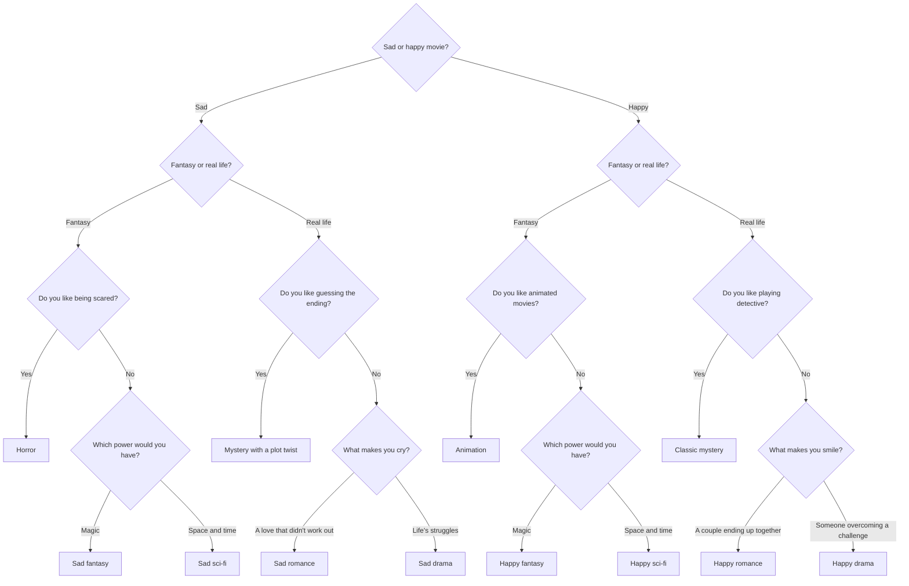

# What movie should I watch today?

**English** | [Português](README.pt-BR.md)

A movie recommender based on a decision tree, built with Google Forms and generated automatically with Google Apps Script.

**Try the form:** [response link](https://docs.google.com/forms/d/e/1FAIpQLSfiQEuMfTH0eHT1FN4OntMRKXevAlpvvmrPPBn_QiwqZe27IA/viewform)

> **Note:** the form and all of its content are in Brazilian Portuguese.

---

## Problem

Build a form that asks the user multiple-choice questions and, based on the answers, sends them through different paths until they reach a personalized final recommendation. The system must have at least three levels of questions and three different results.

---

## Solution

### Overview

| | |
|---|---|
| Questions before the result | 3 to 4 |
| Question sections | 11 |
| Final recommendations | 12 |
| Genres | Horror, fantasy, sci-fi, mystery, romance, drama and animation |

The form works as a simple expert system:

- **Knowledge base:** the questions, the answers and the 12 recommendations.
- **Inference engine:** the navigation rules between sections ("if the answer is X, go to section Y").
- **Indirect questions:** the user never picks a genre directly. Each answer removes options until only one is left.

### Decision tree



**Design decisions:**

- **Mood before genre.** The first question splits sad and happy movies, and each genre has a version for each mood. Horror only exists in the sad branch, and animation only in the happy branch.
- **Duplicate sections to keep context.** Google Forms doesn't store variables between sections. That's why "Fantasy or real life?" appears in two sections: the path itself is what keeps the user's first choice.
- **Most different genre first.** In each group of three genres, a yes/no question separates the most different one. If the answer is no, a second question decides between the other two.

### Recommendations

| Path | Genre | Recommended movie |
|---|---|---|
| Sad → Fantasy → Likes being scared | Horror | Bring Her Back (2025) |
| Sad → Fantasy → Magic | Fantasy | Bridge to Terabithia (2007) |
| Sad → Fantasy → Space and time | Sci-fi | Interstellar (2014) |
| Sad → Real life → Likes guessing | Mystery with a plot twist | Shutter Island (2010) |
| Sad → Real life → A love that didn't work out | Romance | Titanic (1997) |
| Sad → Real life → Life's struggles | Drama | Requiem for a Dream (2000) |
| Happy → Fantasy → Likes animation | Animation | Zootopia (2016) |
| Happy → Fantasy → Magic | Fantasy | Pirates of the Caribbean: The Curse of the Black Pearl (2003) |
| Happy → Fantasy → Space and time | Sci-fi | Back to the Future (1985) |
| Happy → Real life → Likes playing detective | Classic mystery | Murder on the Orient Express (2017) |
| Happy → Real life → A couple ending up together | Romance | Pride & Prejudice (2005) |
| Happy → Real life → Overcoming a challenge | Drama | The Pursuit of Happyness (2006) |

Each result screen shows a text that reflects the user's choices, the recommended movie and a short summary.

### Summaries

- **Bring Her Back (2025):** after losing their father, two siblings move in with a foster mother who is hiding a dark plan to bring back the daughter she lost.
- **Bridge to Terabithia (2007):** two schoolmates create an imaginary kingdom in the woods, where they find a safe place and a friendship that changes their lives.
- **Interstellar (2014):** with Earth close to collapse, a former pilot leaves his children behind to travel through space and find a new home for humanity.
- **Shutter Island (2010):** two federal agents investigate a missing patient at a psychiatric hospital on an isolated island.
- **Titanic (1997):** a young upper-class woman and a poor artist fall in love during the first voyage of the most famous ship in history.
- **Requiem for a Dream (2000):** four people full of dreams slowly watch their lives fall apart because of addiction.
- **Zootopia (2016):** a rookie bunny cop teams up with a con artist fox to solve a series of disappearances in a city of animals.
- **Pirates of the Caribbean: The Curse of the Black Pearl (2003):** a young blacksmith joins forces with an eccentric pirate to rescue the woman he loves from a cursed crew.
- **Back to the Future (1985):** a teenager accidentally travels to the past and has to make sure his parents fall in love so he can get back home.
- **Murder on the Orient Express (2017):** a famous detective must find out who committed a murder on board a luxury train stuck in the snow.
- **Pride & Prejudice (2005):** a strong-minded young woman and a rich, reserved man have to get past their first impressions of each other.
- **The Pursuit of Happyness (2006):** based on a true story, a father with no money and no home fights for a job to give his son a better life.

### Automated generation

The form has 23 sections and 22 navigation rules. To avoid mistakes from setting it up by hand, it's generated by a Google Apps Script file ([`criarFormulario.gs`](criarFormulario.gs)) that creates all the sections, questions, texts and rules at once.

Main part of the logic:

```javascript
// Each answer option points to its target section
item.setChoices(p.opcoes.map(function (o) {
  return item.createChoice(o[0], paginas[o[1]]);
}));

// Result sections submit the form
paginas[n].setGoToPage(FormApp.PageNavigationType.SUBMIT);
```

**How to run it:**

1. Go to [script.google.com](https://script.google.com) and create a new project.
2. Paste the content of `criarFormulario.gs` into the editor and save it.
3. Select the `criarFormulario` function and click **Run**.
4. Allow access to Google Forms when asked.
5. The edit link and the response link show up in the execution log.

---

## Technologies

- Google Forms
- Google Apps Script (JavaScript)

## Author

Made by **Lorena Alves**.
