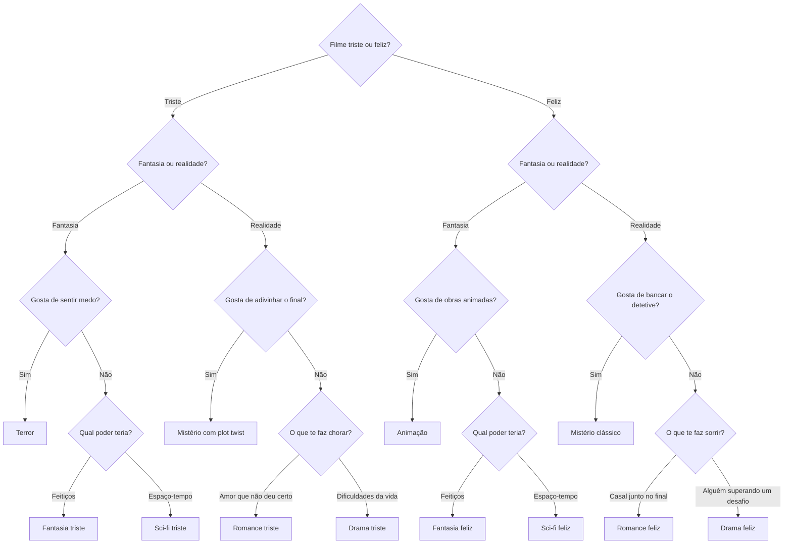

# Qual filme assistir hoje?

[English](README.md) | **Português**

Recomendador de filmes baseado em árvore de decisão, construído no Google Forms e gerado automaticamente com Google Apps Script.

**Testar o formulário:** [link de resposta](https://docs.google.com/forms/d/e/1FAIpQLSfiQEuMfTH0eHT1FN4OntMRKXevAlpvvmrPPBn_QiwqZe27IA/viewform)

---

## Enunciado

Desenvolver um formulário que faça perguntas de múltipla escolha ao usuário e, de acordo com as respostas, o direcione por caminhos diferentes até uma recomendação final personalizada. O sistema deve ter pelo menos três níveis de perguntas e três resultados distintos.

---

## Resultado

### Visão geral

| | |
|---|---|
| Perguntas até o resultado | 3 a 4 |
| Seções de pergunta | 11 |
| Recomendações finais | 12 |
| Gêneros cobertos | Terror, fantasia, ficção científica, mistério, romance, drama e animação |

O formulário funciona como um sistema especialista simples:

- **Base de conhecimento:** as perguntas, as respostas e as 12 recomendações.
- **Motor de inferência:** as regras de navegação entre seções ("se respondeu X, vá para a seção Y").
- **Perguntas indiretas:** o usuário nunca escolhe o gênero diretamente. Cada resposta elimina possibilidades até restar apenas uma.

### Árvore de decisão



**Decisões de projeto:**

- **Clima antes do gênero.** A primeira pergunta separa filmes tristes e felizes, e cada gênero tem uma versão para cada clima. Terror existe apenas no ramo triste, e animação apenas no ramo feliz.
- **Seções duplicadas para guardar o contexto.** O Google Forms não armazena variáveis entre seções. Por isso, a pergunta "Fantasia ou realidade?" existe em duas seções: o caminho percorrido é o que preserva a escolha inicial do usuário.
- **Gênero mais distinto isolado primeiro.** Em cada grupo de três gêneros, uma pergunta de sim ou não separa o mais diferente. Se a resposta for não, uma segunda pergunta decide entre os dois restantes.

### Recomendações

| Caminho | Gênero | Filme recomendado |
|---|---|---|
| Triste → Fantasia → Gosta de medo | Terror | Faça Ela Voltar (2025) |
| Triste → Fantasia → Feitiços | Fantasia | Ponte para Terabítia (2007) |
| Triste → Fantasia → Espaço-tempo | Sci-fi | Interestelar (2014) |
| Triste → Realidade → Gosta de adivinhar | Mistério com plot twist | Ilha do Medo (2010) |
| Triste → Realidade → Amor que não deu certo | Romance | Titanic (1997) |
| Triste → Realidade → Dificuldades da vida | Drama | Réquiem para um Sonho (2000) |
| Feliz → Fantasia → Obras animadas | Animação | Zootopia: Essa Cidade é o Bicho (2016) |
| Feliz → Fantasia → Feitiços | Fantasia | Piratas do Caribe: A Maldição do Pérola Negra (2003) |
| Feliz → Fantasia → Espaço-tempo | Sci-fi | De Volta para o Futuro (1985) |
| Feliz → Realidade → Gosta de bancar o detetive | Mistério clássico | Assassinato no Expresso do Oriente (2017) |
| Feliz → Realidade → Casal junto no final | Romance | Orgulho e Preconceito (2005) |
| Feliz → Realidade → Superação | Drama | À Procura da Felicidade (2006) |

Cada tela de resultado apresenta um texto que retoma as escolhas feitas pelo usuário, o filme recomendado e uma breve sinopse.

### Sinopses

- **Faça Ela Voltar (2025):** após perderem o pai, dois irmãos vão morar com uma mãe adotiva que esconde um plano sombrio para trazer de volta a filha que perdeu.
- **Ponte para Terabítia (2007):** dois colegas de escola criam um reino imaginário na floresta, onde encontram refúgio e uma amizade que muda suas vidas.
- **Interestelar (2014):** com a Terra à beira do colapso, um ex-piloto deixa os filhos para atravessar o espaço em busca de um novo lar para a humanidade.
- **Ilha do Medo (2010):** dois agentes federais investigam o sumiço de uma paciente em um hospital psiquiátrico isolado em uma ilha.
- **Titanic (1997):** uma jovem da alta sociedade e um artista sem dinheiro se apaixonam durante a viagem inaugural do navio mais famoso da história.
- **Réquiem para um Sonho (2000):** quatro pessoas cheias de sonhos veem suas vidas desmoronarem aos poucos por causa do vício.
- **Zootopia: Essa Cidade é o Bicho (2016):** uma coelha policial novata se une a uma raposa trapaceira para resolver uma série de desaparecimentos na cidade dos animais.
- **Piratas do Caribe: A Maldição do Pérola Negra (2003):** um jovem ferreiro se alia a um pirata excêntrico para resgatar a mulher que ama das mãos de uma tripulação amaldiçoada.
- **De Volta para o Futuro (1985):** um adolescente viaja ao passado por acidente e precisa garantir que seus pais se apaixonem para conseguir voltar para casa.
- **Assassinato no Expresso do Oriente (2017):** um famoso detetive precisa descobrir quem cometeu um assassinato a bordo de um trem de luxo preso na neve.
- **Orgulho e Preconceito (2005):** uma jovem de opiniões fortes e um homem rico e reservado precisam superar as primeiras impressões que tiveram um do outro.
- **À Procura da Felicidade (2006):** baseado em uma história real, um pai sem dinheiro e sem casa luta por uma vaga de emprego para dar uma vida melhor ao filho.

### Geração automatizada

O formulário tem 23 seções e 22 regras de navegação. Para evitar erros de configuração manual, ele é gerado por um script em Google Apps Script ([`criarFormulario.gs`](criarFormulario.gs)) que cria todas as seções, perguntas, textos e regras de uma só vez.

Trecho central da lógica:

```javascript
// Cada opção de resposta aponta para a seção de destino
item.setChoices(p.opcoes.map(function (o) {
  return item.createChoice(o[0], paginas[o[1]]);
}));

// As seções de resultado encerram o formulário
paginas[n].setGoToPage(FormApp.PageNavigationType.SUBMIT);
```

**Como executar:**

1. Acesse [script.google.com](https://script.google.com) e crie um novo projeto.
2. Cole o conteúdo de `criarFormulario.gs` no editor e salve.
3. Selecione a função `criarFormulario` e clique em **Executar**.
4. Autorize o acesso ao Google Forms quando solicitado.
5. Os links de edição e de resposta aparecem no registro de execução.

---

## Tecnologias

- Google Forms
- Google Apps Script (JavaScript)

## Autoria

Desenvolvido por **Lorena Alves**.
